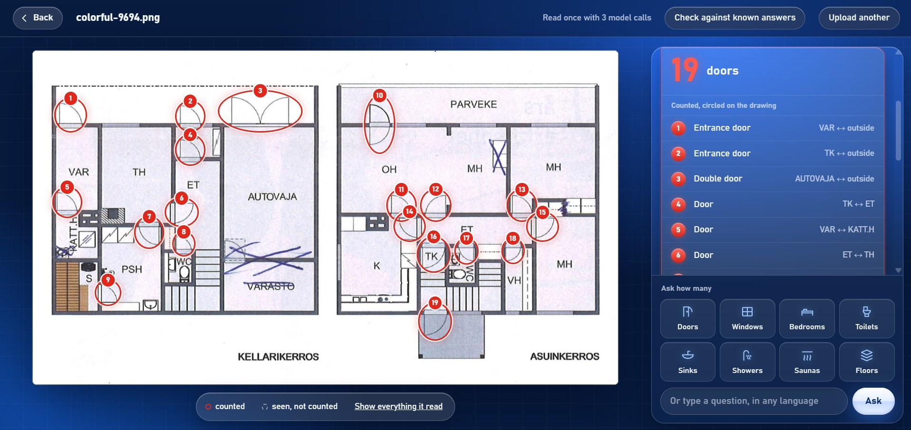

# Make Blueprints Talk

Ask a floor plan how many. Junction 2026, Stoa challenge. Team OneCodeAtATime.

Upload a scanned floor plan and ask how many doors, windows, bedrooms or toilets it has, in
English, Finnish or another language. You get the count, and every counted item is circled and
numbered on the drawing, so a person can check the answer in seconds.

**Live demo: http://70.34.222.185**



## How it works

Each drawing is read **once** into a graph: rooms, doors, windows and fixtures, each with its box
on the drawing. A vision model reads the layout, and a second pass looks at zoomed crops for
small symbols. Every question after that is a query over the graph, not another look at the
image, so it is instant and free. Items it saw but did not count (crossed out, sketched in pen,
cupboard fronts) are listed with the reason.

## Results

On 40 floor plans (750 questions) that were never used for tuning:

| Method | Exact-match accuracy |
|---|---|
| No model: most common answer per question | 58.4% |
| **Graph: Claude Sonnet 5.5 for layout + Claude Fable 5.2 for zoomed symbols** | **78.4%** |

Rooms are reliable (floors and WC rooms 100%, kitchens 93%, bedrooms 83%). Small symbols are not:
doors 53%, windows 37.5%. That is why every answer shows its evidence on the drawing.

Reading a drawing costs 3 vision calls, about 20 cents, once. Each question after that costs nothing.

## Try it

```
git clone -b stoa/make-blueprints-talk https://github.com/lindaako/junction-2026.git
cd junction-2026
python -m venv .venv            # then activate it
pip install -r requirements.txt
```

An Anthropic API key is required to start the app, even to browse the examples. Copy
`.env.example` to `.env` in the repo root using a text editor, and put your key after
`ANTHROPIC_API_KEY=`. Create the file in an editor rather than with `echo ... > .env`: Windows
PowerShell saves redirected output as UTF-16, which the app cannot read.

```
python scripts/stoa_app.py      # open http://127.0.0.1:8100
```

The app starts with five example plans. On a drawing's page, **Check against known answers**
scores the app against answers you paste in.

## Limitations

- Only raster floor plans are covered; the dataset's Swiss DXF and IFC questions are not.
- Windows and doors are unreliable.
- Areas, lengths and schedules are not supported; the app says so rather than guessing.

## More

[docs/details.md](docs/details.md) has the full results per question type, what we tried that did
not help (and why the simpler version won on unseen plans), the rule log from manual error
analysis, cost, limitations, next steps, and how to reproduce every number.

## Credits and license

Code: MIT (`LICENSE`). Example plans: CubiCasa5K (Kalervo, Ylioinas, Häikiö, Karhu, Kannala, 2019,
https://zenodo.org/records/2613548), licensed CC BY-NC-SA 4.0
(https://creativecommons.org/licenses/by-nc-sa/4.0/), as distributed in the Stoa Junction 2026
challenge dataset, some with markings added there; see `examples/LICENSE.md`. The screenshot shows
one of these plans. Vision models: Claude Sonnet 5.5 and Claude Fable 5.2 (Anthropic).
